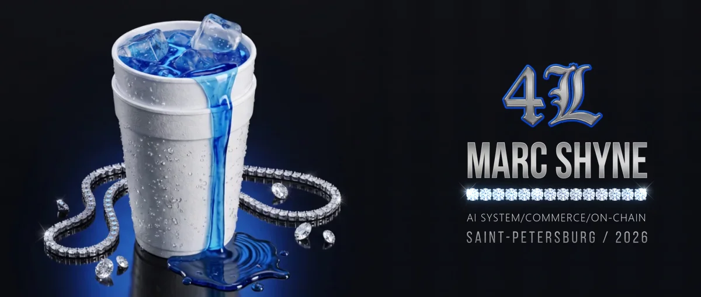

  

  <strong>I build multiplayer games, Telegram apps and the backend systems they run on.</strong>

  
  

## Selected systems

<table>
<tr>
<td colspan="2" valign="top">

### Investment Core — multi-project game platform

A shared backend and admin console for building distinct web and Telegram games. Each project has its own database, participants, economy and configurable mechanics; independent frontends connect through project-scoped APIs.

The admin console can copy a project's configuration into a clean sandbox for testing. Inventory, quests, shops and seasonal rewards share server-side accounting. Three local game implementations cover life simulation, contract-based RPG and squad combat. Recent life-sim work added event-driven goals, career progression and a player wallet.

**Verified:** PostgreSQL integration tests, database restores, safe retries after lost responses and production builds in CI. Live payments and deployment are pending.

`TypeScript` `NestJS` `Next.js` `PostgreSQL` `Prisma` `Docker`

</td>
</tr>
<tr>
<td colspan="2" valign="top">

### Browser MMORPG — multiplayer gameplay and 3D client

Contributed quests, progression, equipment effects and responsive HUD improvements to a real-time browser MMORPG. Prototyped a co-op escort event with server-driven encounters and contribution-based rewards, then tested it with multiple WebSocket clients.

`TypeScript` `Node.js` `WebSocket` `Babylon.js` `Vite` `Vitest` `Playwright`

</td>
</tr>
<tr>
<td width="50%" valign="top">

### [GMM STORE](https://gmmstore.com) — live commerce platform

Merch storefront with catalog, checkout, customer accounts, order management, payment integrations and interactive 3D product views.

`Next.js` `React` `Prisma` `PostgreSQL` `3D`

</td>
<td width="50%" valign="top">

### Fortune City — Telegram Mini App

Contributed game UI, 3D previews and recoverable funding flows to a Telegram game with a server-side economy and Solana integration.

`Next.js` `NestJS` `Prisma` `PostgreSQL` `Solana`

</td>
</tr>
<tr>
<td width="50%" valign="top">

### GOJO — AI operations

Private Telegram system for persistent tasks, shared memory, guarded GitHub work and approval-gated content publishing. Its lightweight publishing workflow is live; coding workflows are part of the wider system.

`TypeScript` `Codex` `Telegram` `SQLite` `Linux sandboxing`

</td>
<td width="50%" valign="top">

### HASHGRID — on-chain GPU economy

Wallet-connected game with GPU infrastructure, upgrades, repair, rewards, withdrawals and referrals.

`Solana` `Anchor` `Rust` `React` `Node.js`

</td>
</tr>
</table>

Most source repositories are private. Project status is described above; the GMM Store link opens the public site.

## Engineering experience

- **Real-time games** — WebSocket state sync, server-side combat and rewards, inventory and progression.
- **Full-stack development** — React and Next.js interfaces, TypeScript and Python services, PostgreSQL data models and project-scoped APIs.
- **Accounting and recovery** — transactional ledgers, idempotent writes, database migrations and recovery drills with populated databases.
- **Testing and CI** — desktop and mobile browser tests, scripted multiplayer sessions, sustained-load tests and GitHub Actions.
- **AI and Telegram automation** — persistent jobs, shared memory, moderation workflows and approval-gated agent actions.
- **Browser 3D** — Babylon.js material and equipment effects, Blender asset workflows and interactive product viewers.

## Working set

  

## Contribution game

  

  <a href="https://t.me/marcshyne"><strong>MAKE SOMETHING MOVE →</strong></a>

